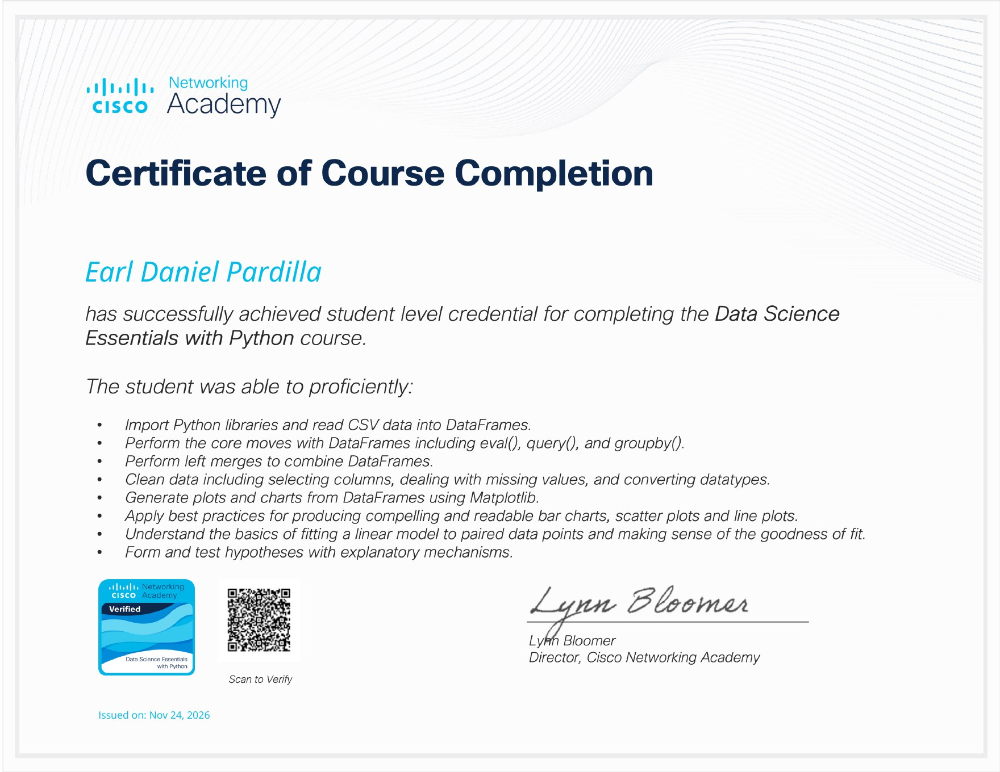
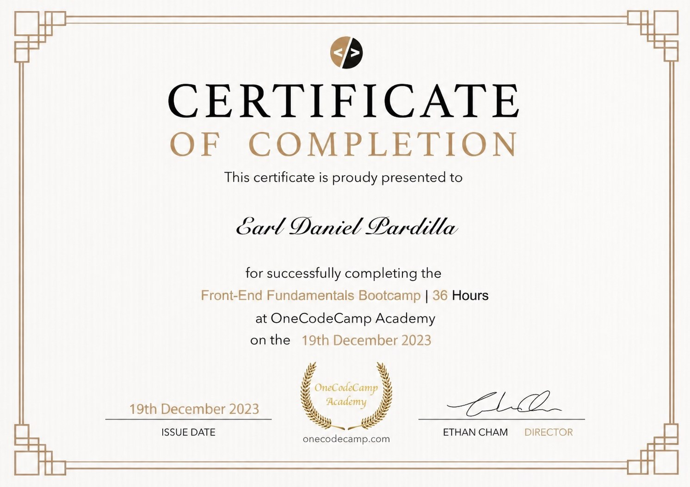

# Hi, I'm Earl Daniel Pardilla 👋

**Computer Science Student | Aspiring Software Engineer | AI/ML & Data Enthusiast**

I'm a Computer Science student at the **Technological Institute of the Philippines (T.I.P.), Manila**, interested in building practical software with **machine learning, computer vision, natural language processing, and web technologies**. I enjoy turning ideas into working applications, experimenting with AI models, and developing systems that solve real-world problems.

- 🎓 **B.S. Computer Science**, T.I.P. Manila — expected April 2027
- 🏅 **Dean's List**, 1st and 2nd Semesters, A.Y. 2024–2025
- 👥 **Project leadership:** Led a four-member team for SchemaLens
- 🧪 Currently working on a thesis about feeder-load anomaly detection and shape classification
- 🌱 Continuously learning and building projects in AI/ML and software development

## 🛠️ Technical Skills

**Programming Languages**  

**AI, Machine Learning & Data Science**  

**Web Development & Tools**  

Other tools and technologies I have worked with include **EasyOCR, REST APIs, Google Colab, Streamlit, Chart.js, and Ollama**.

## 🚀 Featured Projects

- **[StudyAgent](https://github.com/danielpardilla/StudyAgent.git)** · *Solo project* — Real-time study-focus monitoring using YOLOv8, OpenCV, and a four-state monitoring system; persistence thresholds reduced state changes by approximately **85–90%**. `Python` `OpenCV` `YOLOv8`
- **[SchemaLens](https://github.com/danielpardilla/Schema-Lens.git)** · *Team Leader, 4 members* — AI-powered SQL learning platform that extracts database schemas from images and generates SQL from natural-language requests. `Flask` `SQLAlchemy` `SQLite` `EasyOCR` `Gemini`
- **[Hive Net Café](https://github.com/danielpardilla/Hive-Internet-Cafe.git)** · *Full-stack project* — LAN-based internet café system for 15 PCs, with real-time sessions, peso billing, print management, analytics, and local AI insights. `Flask` `Flask-SocketIO` `SQLite` `Chart.js` `Ollama`
- **[Persian Character Recognition](https://github.com/danielpardilla/PersianCharacterRecognition.git)** · *Team project, 6 members* — MobileNetV3-Small classifiers for 32 Persian letters, achieving **98.61% accuracy** on 7,988 held-out test images. `PyTorch` `MobileNetV3-Small` `Streamlit`

## 🔬 Research

**Feeder-Load Anomaly Detection and Shape Classification** · *Thesis Group Leader, ongoing (expected April 2027)* — Preparing and analyzing load records from eight BATELEC I feeders and exploring local/hourly anomaly checks with six synthetic load shapes and a proposed Random Forest classifier. `Python` `Jupyter` `Google Colab`

## 📜 Certifications & Professional Development

- **Data Science Essentials with Python** — Cisco Networking Academy · Issued November 24, 2026
- **Dev Days: Exploring GitHub Copilot** — Microsoft Campus Club PUP · October 2026
- **Front-End Fundamentals Bootcamp (36 hours)** — OneCodeCamp Academy · December 19, 2023

### Certificate Gallery

  
  

## 🎯 Career Interests

- **Software Development & Software Engineering** — building reliable, practical applications and systems
- **AI Engineering & Applied Machine Learning** — developing intelligent solutions with machine learning, computer vision, and NLP
- **Data & Analytics** — working with data processing, analysis, visualization, and predictive modeling

## 🤝 Connect With Me

I'm open to internship opportunities, collaborative projects, and learning from other developers.

- 📧 **Email:** [daniel.pardilla01@gmail.com](mailto:daniel.pardilla01@gmail.com)
- 💼 **LinkedIn:** www.linkedin.com/in/earl-daniel-pardilla

---

⭐ *Thanks for visiting my profile! Feel free to explore my repositories and projects.*

<!--
SETUP NOTE:
1. Create a public GitHub repository whose name exactly matches your GitHub username.
2. Add this file to that repository and name it README.md.
3. Replace the project repository placeholders with your actual repository URLs.
4. Add your actual LinkedIn and GitHub profile URLs in the Connect With Me section.
5. Keep the `assets/certificates/` folder in the repository so the certificate previews display correctly.
6. Keep project descriptions and metrics updated as your work evolves.
-->
